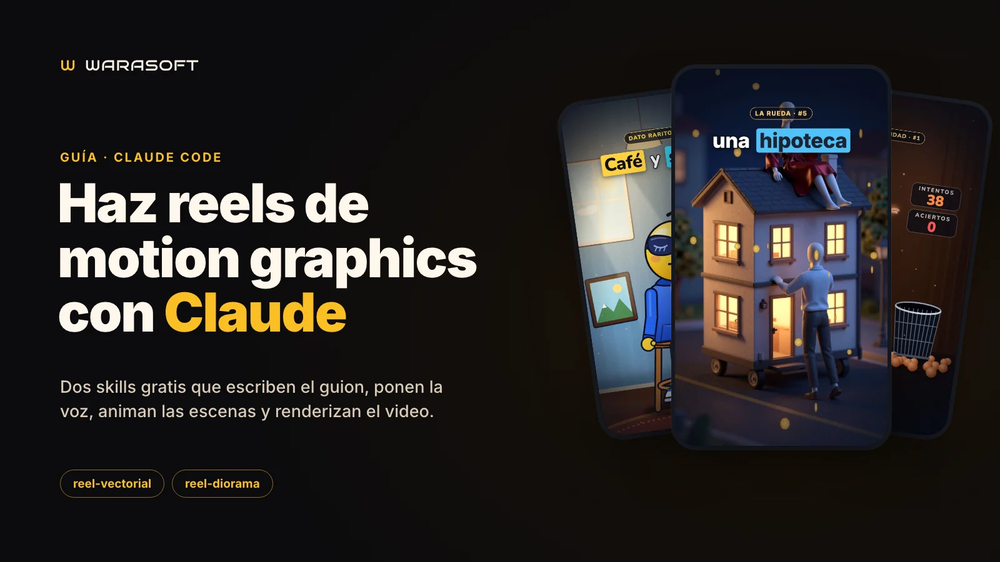
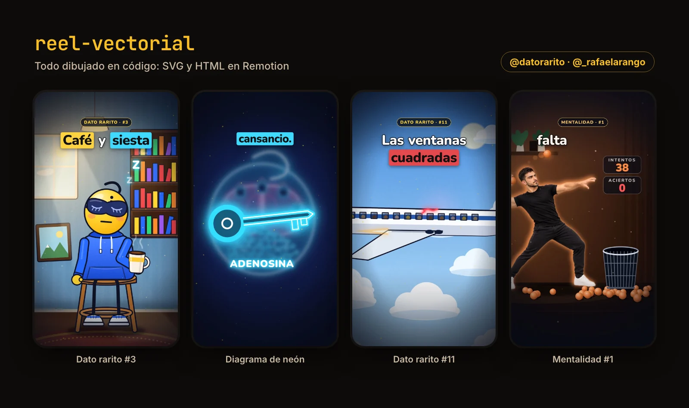
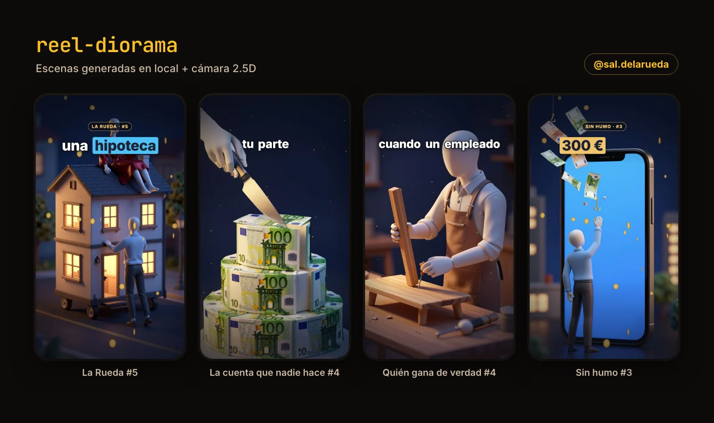
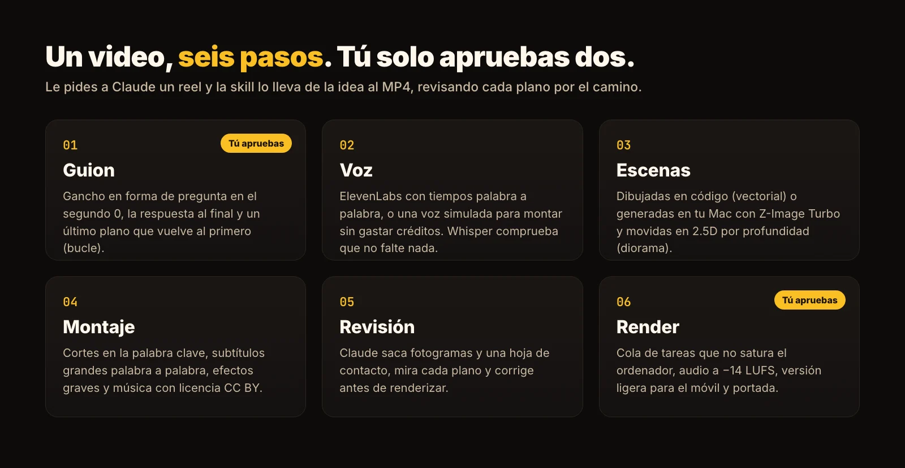

# warasoft-reels · Motion graphics reels with Claude Code

*[Leer en español](README.md)*



Two **Claude Code skills** that produce vertical reels (1080×1920, 30 fps, 35–55 s) end to end: hook-driven script, AI voice with per-word timings, animated scenes, captions, music, cover and render. You ask Claude "make me a reel about…" and only approve the script and the draft.

They're what we use at [Warasoft](https://warasoft.com) for our Instagram accounts. Full guide with examples: **[How to make motion graphics reels with Claude](https://warasoft.com/blog/reels-with-claude-skills/)**.

| Skill | Style | Example |
|---|---|---|
| [`reel-vectorial`](plugins/reel-vectorial/skills/reel-vectorial/SKILL.md) | Everything drawn in code (SVG/HTML in Remotion), no image generator | [@datorarito](https://www.instagram.com/datorarito/) |
| [`reel-diorama`](plugins/reel-diorama/skills/reel-diorama/SKILL.md) | Night-time 3D dioramas generated locally (Z-Image Turbo) with a 2.5D depth camera (Depth Pro) | [@sal.delarueda](https://www.instagram.com/sal.delarueda/) |

The skills are written in Spanish; Claude follows them in whatever language you write to it.




## Install

In an empty folder for your reels, open Claude Code (`claude`) and type:

```text
/plugin marketplace add rafacu-dev/warasoft-reels
/plugin install reel-vectorial@warasoft-reels
/plugin install reel-diorama@warasoft-reels
```

Choose "Install for you" to have them in every project. More in the [Claude Code plugin docs](https://code.claude.com/docs/en/discover-plugins).

**Manual install:** copy `plugins/<skill>/skills/<skill>` into `~/.claude/skills/`.

## Getting started

1. **Set up an account.** Ask Claude: *"Set up the reel-vectorial kit for my account @my.brand"*.
   - It creates `cuentas/<account>/` with the Remotion project, a demo video with a simulated voice and an empty `.env` (mode 600).
   - Then it asks about your brand: palette, main character, music and call to action.
2. **reel-diorama only:** prepare the image environment once. It downloads the models into `~/imggen/.venv`:
   ```bash
   bash <skill-folder>/scripts/preparar-entorno.sh
   ```
   Claude tells you the path.
3. **(Optional) Real voice:** put your ElevenLabs key in the account's `.env`. Never paste it in the chat. Without a key you can build everything with the simulated voice, but it isn't delivered.
4. **Ask for a video:** *"Make me a 40-second reel for @my.brand about…"*. Claude writes the script and waits for your approval, then produces the video and leaves it in `cuentas/<account>/videos/borradores/`.

Each skill documents every step in its `references/` folder (`instalacion.md`, `guion.md`, `produccion.md`…).



## Requirements

| | reel-vectorial | reel-diorama |
|---|---|---|
| System | macOS (tested on Apple Silicon); Linux with fallbacks; Windows via WSL | Apple Silicon Mac |
| Memory | Any recent Mac | 32 GB recommended (24 GB is tight; 16 GB not recommended) |
| Disk | ≈1 GB per project | ≈45 GB free for the models |
| Software | Claude Code, Node.js 20+, Python 3.10+, ffmpeg | Same, plus Python 3.11+ for the image environment |
| Optional | Google Chrome (otherwise Remotion downloads its own), ElevenLabs key, Whisper (`transformers` + `torch`) to check the voice | Same |

## Licenses

- **This repository:** [MIT](LICENSE).
- **[Remotion](https://www.remotion.dev/license):** free for individuals and companies of up to 3 people; others need a company license.
- **reel-diorama models:** Z-Image Turbo (Apache 2.0), Depth Pro (Apple's license, `apple/ml-depth-pro`) and mflux (MIT).
- **Voice:** a free ElevenLabs plan can't be used commercially.
- **Audio:** no sound effects or music are bundled. The scripts generate the effects with your own key, or you can use CC0 sounds. The recommended music is by Kevin MacLeod ([incompetech.com](https://incompetech.com), CC BY): credit it in the caption.
- **Instagram:** label reels as "AI content" when the voice or images are generated.

---

Made by [Warasoft](https://warasoft.com). Want it set up for your business? Email [contact@warasoft.com](mailto:contact@warasoft.com).
