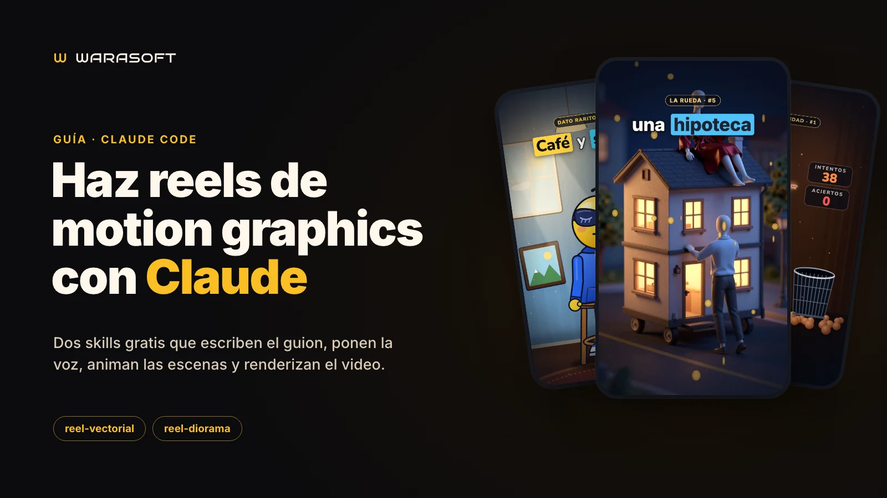
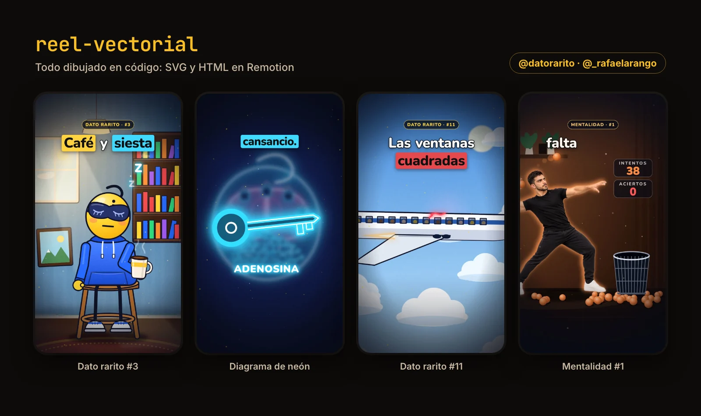
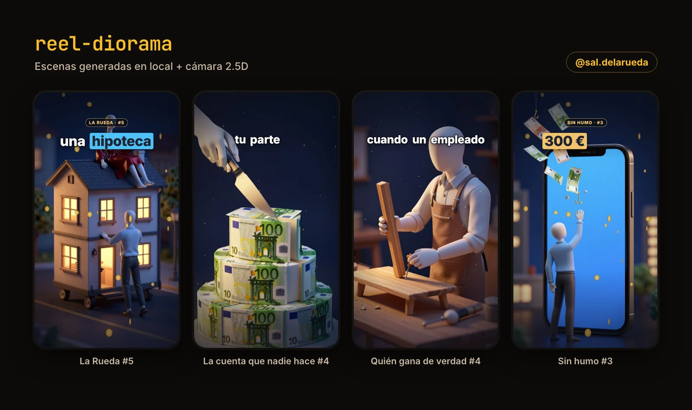
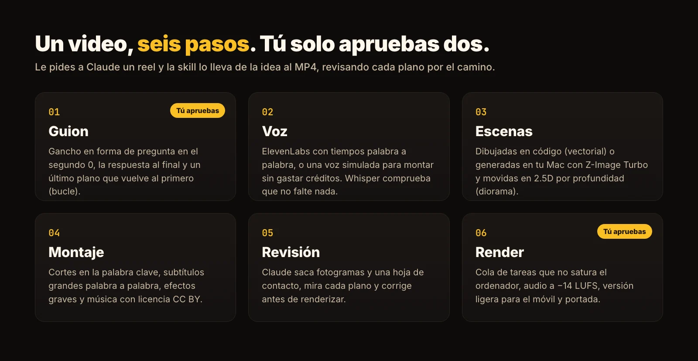

# warasoft-reels · Reels de motion graphics con Claude Code

*[Read in English](README.en.md)*



Dos **skills de Claude Code** para producir reels verticales (1080×1920, 30 fps, 35–55 s) de principio a fin: guion con gancho, voz IA con tiempos palabra a palabra, escenas animadas, subtítulos, música, portada y render. Le pides a Claude "hazme un reel sobre…" y tú solo apruebas el guion y el borrador.

Son las que usamos en [Warasoft](https://warasoft.com) para nuestras cuentas de Instagram. Guía completa con ejemplos: **[Cómo hacer reels de motion graphics con Claude](https://warasoft.com/es/blog/reels-con-claude-skills/)**.

| Skill | Estilo | Ejemplo |
|---|---|---|
| [`reel-vectorial`](plugins/reel-vectorial/skills/reel-vectorial/SKILL.md) | Todo dibujado en código (SVG/HTML en Remotion), sin generador de imágenes | [@datorarito](https://www.instagram.com/datorarito/) |
| [`reel-diorama`](plugins/reel-diorama/skills/reel-diorama/SKILL.md) | Dioramas 3D nocturnos generados en local (Z-Image Turbo) con cámara 2.5D por profundidad (Depth Pro) | [@sal.delarueda](https://www.instagram.com/sal.delarueda/) |




## Instalación

En una carpeta vacía para tus reels, abre Claude Code (`claude`) y escribe:

```text
/plugin marketplace add rafacu-dev/warasoft-reels
/plugin install reel-vectorial@warasoft-reels
/plugin install reel-diorama@warasoft-reels
```

Elige "Install for you" para tenerlas en todos tus proyectos. Más información en la [documentación de plugins de Claude Code](https://code.claude.com/docs/en/discover-plugins).

**Instalación manual:** copia `plugins/<skill>/skills/<skill>` en `~/.claude/skills/`.

## Primeros pasos

1. **Monta una cuenta.** Pídeselo a Claude: *"Monta el kit de reel-vectorial para mi cuenta @mi.marca"*.
   - Crea `cuentas/<cuenta>/` con el proyecto de Remotion, un video de demostración con voz simulada y un `.env` vacío (permisos 600).
   - Después te pregunta por la marca: paleta, protagonista, música y llamada a la acción.
2. **Solo para reel-diorama:** prepara el entorno de imágenes una vez. Descarga los modelos en `~/imggen/.venv`:
   ```bash
   bash <carpeta-de-la-skill>/scripts/preparar-entorno.sh
   ```
   Claude te dice la ruta.
3. **(Opcional) Voz real:** pega tu clave de ElevenLabs en el `.env` de la cuenta. Nunca la pegues en el chat. Sin clave, todo se monta con la voz simulada, pero no se entrega.
4. **Pide un video:** *"Hazme un reel de 40 segundos para @mi.marca sobre…"*. Claude escribe el guion y espera tu visto bueno; luego produce el video y lo deja en `cuentas/<cuenta>/videos/borradores/`.

Los detalles de cada paso están en `references/` dentro de cada skill (`instalacion.md`, `guion.md`, `produccion.md`…).



## Requisitos

| | reel-vectorial | reel-diorama |
|---|---|---|
| Sistema | macOS (probado en Apple Silicon); Linux con alternativas; Windows con WSL | Mac con Apple Silicon |
| Memoria | La de cualquier Mac reciente | 32 GB recomendados (24 GB justos; 16 GB no recomendado) |
| Disco | ≈1 GB por proyecto | ≈45 GB libres para los modelos |
| Software | Claude Code, Node.js 20+, Python 3.10+, ffmpeg | Igual, más Python 3.11+ para el entorno de imágenes |
| Opcional | Google Chrome (si no, Remotion descarga el suyo), clave de ElevenLabs, Whisper (`transformers` + `torch`) para comprobar la voz | Igual |

## Licencias

- **Este repositorio:** [MIT](LICENSE).
- **[Remotion](https://www.remotion.dev/license):** gratis para personas y empresas de hasta 3 personas; las demás necesitan licencia de empresa.
- **Modelos de reel-diorama:** Z-Image Turbo (Apache 2.0), Depth Pro (licencia de Apple, `apple/ml-depth-pro`) y mflux (MIT).
- **Voz:** un plan gratuito de ElevenLabs no permite uso comercial.
- **Audio:** no se incluyen efectos ni música. Los scripts generan los efectos con tu propia clave, o puedes usar sonidos CC0. La música recomendada es de Kevin MacLeod ([incompetech.com](https://incompetech.com), CC BY): pon la atribución en el caption.
- **Instagram:** etiqueta los reels como "contenido de IA" cuando la voz o las imágenes sean generadas.

---

Hecho por [Warasoft](https://warasoft.com). ¿Lo quieres montado para tu negocio? Escríbenos a [contact@warasoft.com](mailto:contact@warasoft.com).
